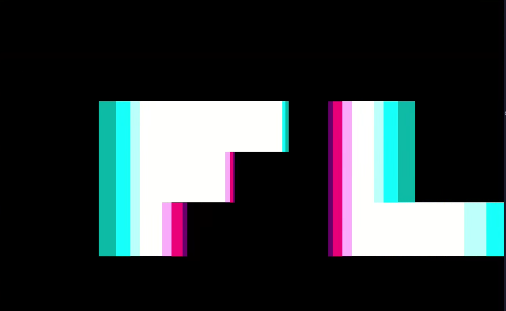

# Oohs - 255 byte intro presented @FlashParty 2026



**Oohs** is a 256 byte MSDOS intro. It is an attempt to reproduce the parallax scroll effect that appears in **ReMODed** demo by **7dump** and **SandS**. I love that demo and I wanted to reproduce the basic effect in 256 bytes. I recommend you watch the full demo here:

   • [ReMODed demo by 7dump and SandS](https://www.youtube.com/watch?v=gKUF5pLJSW0)

In this implementation I was able to render the text **"Flash Party"** with the parallax effect and using the colors from the standard VGA palette. I was able to get the main effect with the text to 170 bytes. The rest is the music which turned out quite interesting in my opinion.


Run with:

```
$ dosbox -conf dosbox.conf fp26.com
```

Source code is provided and can be compiled with:

```
$ nasm fp26.asm -fbin -O0 -o fp26.com
```

I developed this on a Linux box. To hear the audio you need to be running timidity on another terminal with the following command:

$ timidity -iA -p12 --module=32

## About the demo

One important aspect of this demo is that I did use AI throughout the development process: I used it to understand the original code, to debug strange bugs and help to simplify the assembler and use 80x86 instructions that I did not know to reduce the size. I have included my full Claude session in the file `claude-session.md` I also asked Claude to reduce the size and he got it to 223 bytes (compared to my 255). I will write a long article about how I used AI because I learned a lot during the process and I think it might be useful for others. This repo also contains also the version that Claude generated.

## Links

- [Demozoo entry](https://demozoo.org/productions/400197/) - The entry in Demozoo
- [Pouet entry](https://www.pouet.net/prod.php?which=107295) - The entry in Pouet demo site.
- [YouTube Video](https://www.youtube.com/watch?v=2M6MJiqjPb4) - The capture of the demo. Crank up the volume because audio is also key to this little demo.
- [Shader toy](https://www.shadertoy.com/view/sX3SDf) - Before coding the demo in 80x86 I created a proof of concept Shadertoy version of the effect to make sure it was small enough to be able to make it in 256 bytes or less.
